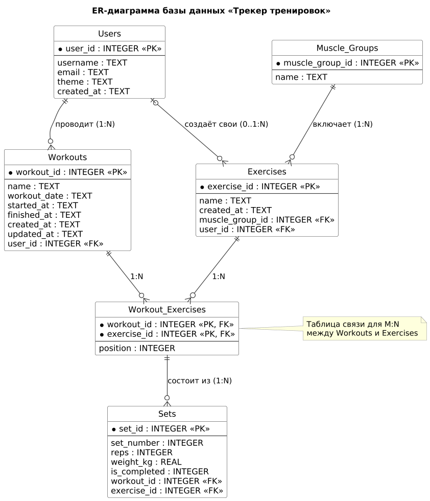

# workout-tracker-srs

Техническое задание, план проекта, прототип и проект базы данных приложения «Трекер тренировок»: планирование тренировок, учёт подходов, повторений и весов.

## Приложение

Прототип написан на HTML, CSS и JavaScript, без сборки и сторонних библиотек.

Что умеет версия 1.0.0:

- создание тренировки с названием и датой, список тренировок по дате;
- изменение и удаление запланированной тренировки;
- запуск и отмена тренировки, активная тренировка показана в шапке страницы;
- справочник из 22 упражнений по 6 группам мышц;
- автоматическое сохранение данных в браузере (localStorage).

### Как запустить

1. Скачайте репозиторий: кнопка **Code → Download ZIP** или архив из [релиза v1.0.0](https://github.com/KirillS997/workout-tracker-srs/releases/tag/v1.0.0).
2. Распакуйте архив и откройте файл `index.html` в браузере.

### Файлы

| Файл | Назначение |
|---|---|
| `index.html` | Разметка страницы |
| `style.css` | Стили |
| `script.js` | Логика приложения |
| `.github/workflows/ci.yml` | Автоматическая проверка (GitHub Actions) |
| `database/` | SQL-скрипты базы данных и описание нормализации |
| `docs/database/` | Анализ предметной области и ER-диаграмма |

## База данных

Спроектирована реляционная база данных для SQLite, приведённая к третьей нормальной форме. В ней 6 таблиц: пользователи, группы мышц, упражнения, тренировки, упражнения в составе тренировки и подходы.

| Файл | Содержимое |
|---|---|
| [`database/schema.sql`](database/schema.sql) | Создание таблиц, ограничения и индексы |
| [`database/seed_data.sql`](database/seed_data.sql) | Тестовые данные |
| [`database/normalization.md`](database/normalization.md) | Процесс нормализации до 3NF и проверочные запросы |
| [`docs/database/domain_analysis.md`](docs/database/domain_analysis.md) | Анализ предметной области: сущности, атрибуты, связи |
| [`docs/database/er_diagram.png`](docs/database/er_diagram.png), [`.svg`](docs/database/er_diagram.svg), [`.puml`](docs/database/er_diagram.puml) | ER-диаграмма и её исходник в PlantUML |

Как проверить скрипты: откройте [sqliteonline.com](https://sqliteonline.com/), выполните содержимое `schema.sql`, затем `seed_data.sql`.

Прототип пока хранит данные в браузере (localStorage). База данных — проект хранилища для следующих версий.

## Лабораторная работа №1 — Требования

- [Техническое задание (Wiki)](https://github.com/KirillS997/workout-tracker-srs/wiki/Техническое-задание)

## Лабораторная работа №2 — Планирование проекта

- [План проекта и роли (Wiki)](https://github.com/KirillS997/workout-tracker-srs/wiki/План-проекта)
- [Диаграмма Ганта (Roadmap)](https://github.com/users/KirillS997/projects/1/views/2)
- [Беклог: 25 задач (Issues)](https://github.com/KirillS997/workout-tracker-srs/issues)
- [Вехи проекта (Milestones)](https://github.com/KirillS997/workout-tracker-srs/milestones)

## Лабораторная работа №3 — Реализация и контроль версий

- [Процесс разработки (Wiki)](https://github.com/KirillS997/workout-tracker-srs/wiki/Процесс-разработки)
- [Pull Requests](https://github.com/KirillS997/workout-tracker-srs/pulls?q=is%3Apr+is%3Aclosed)
- [Запуски CI (Actions)](https://github.com/KirillS997/workout-tracker-srs/actions)
- [Релиз v1.0.0](https://github.com/KirillS997/workout-tracker-srs/releases/tag/v1.0.0)

## Лабораторная работа №4 — Моделирование данных

- [Нормализация базы данных (Wiki)](https://github.com/KirillS997/workout-tracker-srs/wiki/normalization)
- [ER-диаграмма](docs/database/er_diagram.png)
- [DDL-скрипт schema.sql](database/schema.sql) и [тестовые данные seed_data.sql](database/seed_data.sql)
- [Pull Request с проектом базы данных](https://github.com/KirillS997/workout-tracker-srs/pull/32)
