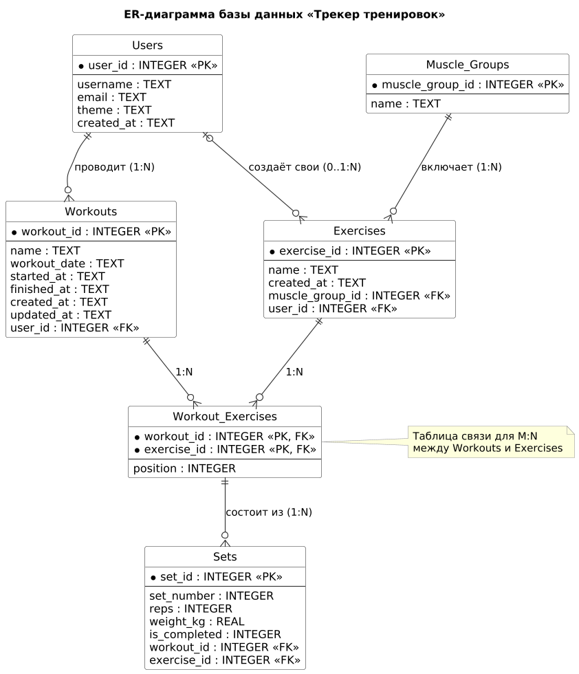

# Процесс проектирования и нормализации базы данных

Документ описывает, как из одной «плоской» таблицы получена схема базы данных приложения «Трекер тренировок» в третьей нормальной форме (3NF).

Связанные файлы: [анализ предметной области](../docs/database/domain_analysis.md), [schema.sql](schema.sql), [seed_data.sql](seed_data.sql).

## 1. Исходная (денормализованная) структура

Для демонстрации процесса нормализации взята таблица, которая хранит все данные в одном месте. Одна строка — одно упражнение в одной тренировке:

`Workout_Log_Flat (workout_id, workout_name, workout_date, user_id, username, user_email, exercise_id, exercise_name, muscle_group_id, muscle_group_name, sets)`

| workout_id | workout_name | workout_date | user_id | username | user_email | exercise_id | exercise_name | muscle_group_id | muscle_group_name | sets |
|---|---|---|---|---|---|---|---|---|---|---|
| 1 | Грудь и трицепс | 2026-11-02 | 1 | kirill_sayko | kirill@example.com | 1 | Жим штанги лёжа | 1 | Грудь | 10x60, 8x65, 6x70 |
| 1 | Грудь и трицепс | 2026-11-02 | 1 | kirill_sayko | kirill@example.com | 3 | Отжимания на брусьях | 1 | Грудь | 12x0, 10x0 |
| 4 | Грудь и трицепс | 2026-11-09 | 1 | kirill_sayko | kirill@example.com | 1 | Жим штанги лёжа | 1 | Грудь | 10x62.5, 8x67.5, 5x72.5 |
| 7 | Всё тело | 2026-11-10 | 2 | anna_smirnova | anna@example.com | 1 | Жим штанги лёжа | 1 | Грудь | 10x30, 10x32.5 |

**Проблемы исходной структуры:**

- **Избыточность:** имя и почта пользователя повторяются в каждой строке его тренировок, название упражнения и группа мышц — в каждой тренировке, где оно выполнялось.
- **Аномалия обновления:** если пользователь сменит почту или упражнение переименуют, придётся обновлять все строки, где они встречаются. Пропущенная строка даст противоречивые данные.
- **Аномалия удаления:** при удалении единственной тренировки пользователя теряется информация о самом пользователе. При удалении единственной тренировки с упражнением оно пропадает из справочника.
- **Аномалия вставки:** нельзя добавить упражнение в справочник, пока оно не использовано ни в одной тренировке.

## 2. Нормализация до 1NF (Первая нормальная форма)

**Цель:** убедиться, что все атрибуты атомарны и в таблице нет повторяющихся групп.

- **Что было не так:** в ячейке `sets` записано несколько подходов через запятую (`'10x60, 8x65, 6x70'`), а внутри каждого подхода — два значения: повторения и вес. Это нарушает 1NF. По такой ячейке нельзя запросом найти максимальный вес, посчитать тоннаж или отметить один подход выполненным.
- **Наши действия:** каждый подход вынесен в отдельную строку. Вместо `sets` появились атомарные атрибуты `set_number`, `reps`, `weight_kg`, `is_completed`.
- **Результат:** в каждой ячейке одно значение. Строку однозначно определяет составной ключ `(workout_id, exercise_id, set_number)`.

`Workout_Log_1NF (workout_id, exercise_id, set_number, reps, weight_kg, is_completed, workout_name, workout_date, user_id, username, user_email, exercise_name, muscle_group_id, muscle_group_name)`

| workout_id | exercise_id | set_number | reps | weight_kg | is_completed | workout_name | … | exercise_name | … |
|---|---|---|---|---|---|---|---|---|---|
| 1 | 1 | 1 | 10 | 60 | 1 | Грудь и трицепс | … | Жим штанги лёжа | … |
| 1 | 1 | 2 | 8 | 65 | 1 | Грудь и трицепс | … | Жим штанги лёжа | … |
| 1 | 1 | 3 | 6 | 70 | 1 | Грудь и трицепс | … | Жим штанги лёжа | … |

Избыточность при этом выросла: данные тренировки и упражнения теперь повторяются в каждом подходе. Её устраняют следующие шаги.

## 3. Нормализация до 2NF (Вторая нормальная форма)

**Цель:** устранить частичные зависимости неключевых атрибутов от первичного ключа.

- **Что было не так:** ключ таблицы составной, а часть атрибутов зависит только от его части:

  | Атрибуты | От чего зависят на самом деле |
  |---|---|
  | `workout_name`, `workout_date`, `user_id`, `username`, `user_email` | только от `workout_id` |
  | `exercise_name`, `muscle_group_id`, `muscle_group_name` | только от `exercise_id` |
  | `reps`, `weight_kg`, `is_completed` | от всего ключа `(workout_id, exercise_id, set_number)` |

  Первые две строки — частичные зависимости.
- **Наши действия:** данные тренировки и данные упражнения вынесены в отдельные таблицы. В таблице подходов остались только ссылки `workout_id` и `exercise_id`.
- **Результат:** в каждой таблице неключевые атрибуты зависят от всего первичного ключа.

```
Workouts  (workout_id PK, name, workout_date, user_id, username, user_email)
Exercises (exercise_id PK, name, muscle_group_id, muscle_group_name)
Sets      (workout_id, exercise_id, set_number — составной PK, reps, weight_kg, is_completed)
```

## 4. Нормализация до 3NF (Третья нормальная форма)

**Цель:** устранить транзитивные зависимости, когда неключевой атрибут зависит от другого неключевого атрибута.

- **Что было не так:**
  - В `Workouts` поля `username` и `user_email` зависят от `user_id`, а не напрямую от `workout_id`: `workout_id → user_id → username, user_email`.
  - В `Exercises` поле `muscle_group_name` зависит от `muscle_group_id`, а не напрямую от `exercise_id`: `exercise_id → muscle_group_id → muscle_group_name`.
- **Наши действия:** созданы таблицы `Users (user_id, username, email)` и `Muscle_Groups (muscle_group_id, name)`. В `Workouts` и `Exercises` остались только внешние ключи `user_id` и `muscle_group_id`.
- **Результат:** все неключевые атрибуты зависят только от первичного ключа своей таблицы.

По той же причине в схеме нет полей «статус» и «длительность» тренировки. Оба значения следуют из `started_at` и `finished_at`, то есть зависели бы от неключевых атрибутов:

| Значение | Как определяется |
|---|---|
| Запланирована | `started_at` пуст |
| Идёт | `started_at` заполнен, `finished_at` пуст |
| Завершена | `finished_at` заполнен |
| Длительность | `finished_at − started_at` |

Тоннаж, максимальный вес и расчётный одноповторный максимум тоже не хранятся: они вычисляются из подходов (примеры запросов — в разделе 7).

## 5. Реализация связей «Многие-ко-многим» (M:N)

- **Суть:** в тренировке много упражнений, а одно упражнение входит во много тренировок. В реляционной БД такую связь нельзя задать напрямую одним внешним ключом.
- **Наше решение:** создана промежуточная таблица `Workout_Exercises (workout_id, exercise_id, position)` с составным первичным ключом `(workout_id, exercise_id)`.
- **Что это даёт:**
  - Составной ключ не позволяет добавить одно упражнение в тренировку дважды — это требование задачи [#2](https://github.com/KirillS997/workout-tracker-srs/issues/2).
  - Упражнение можно добавить в тренировку ещё до первого подхода, например в запланированную тренировку.
  - Таблица `Sets` ссылается на пару `(workout_id, exercise_id)` из `Workout_Exercises`. Поэтому подход нельзя записать для упражнения, которого нет в тренировке.
  - `position` хранит порядок упражнений. Он зависит от всей пары «тренировка + упражнение», поэтому 2NF не нарушается.

## 6. Финальная схема



Исходник диаграммы: [er_diagram.puml](../docs/database/er_diagram.puml) (PlantUML).

- `Users (user_id PK, username, email, theme, created_at)`
- `Muscle_Groups (muscle_group_id PK, name)`
- `Exercises (exercise_id PK, name, created_at, muscle_group_id FK, user_id FK)`
- `Workouts (workout_id PK, name, workout_date, started_at, finished_at, created_at, updated_at, user_id FK)`
- `Workout_Exercises (workout_id FK, exercise_id FK, position)` — составной PK
- `Sets (set_id PK, set_number, reps, weight_kg, is_completed, workout_id FK, exercise_id FK)`

**Что добавлено по сравнению с шагами нормализации:**

- `Users.theme` — выбранная тема оформления (ТЗ, раздел 4).
- `Exercises.user_id` — автор собственного упражнения; у предустановленных упражнений поле пустое (ТЗ, 2.3).
- `Workouts.started_at`, `Workouts.finished_at` — фактическое время начала и завершения. `workout_date` — плановая дата, она может не совпадать с датой начала.
- `Sets.set_id` — суррогатный первичный ключ. Номер подхода пересчитывается при удалении подходов (задача [#12](https://github.com/KirillS997/workout-tracker-srs/issues/12)), поэтому он неудобен как часть первичного ключа. Естественный ключ `(workout_id, exercise_id, set_number)` сохранён как ограничение `UNIQUE`.

**Проверка 3NF по таблицам:**

| Таблица | Ключ | Неключевые атрибуты | Зависят только от ключа |
|---|---|---|---|
| Users | `user_id` | `username`, `email`, `theme`, `created_at` | да |
| Muscle_Groups | `muscle_group_id` | `name` | да |
| Exercises | `exercise_id` | `name`, `created_at`, `muscle_group_id`, `user_id` | да |
| Workouts | `workout_id` | `name`, `workout_date`, `started_at`, `finished_at`, `created_at`, `updated_at`, `user_id` | да |
| Workout_Exercises | `(workout_id, exercise_id)` | `position` | да, от всего ключа |
| Sets | `set_id` | `set_number`, `reps`, `weight_kg`, `is_completed`, `workout_id`, `exercise_id` | да |

**Ограничения целостности в `schema.sql`:**

| Правило | Ограничение |
|---|---|
| Повторения — целое число от 1 до 999 | `CHECK` на `Sets.reps` |
| Вес — от 0 до 500 кг с шагом 0,5 | `CHECK` на `Sets.weight_kg` |
| У выполненного подхода заполнены повторения и вес | `CHECK` на таблице `Sets` |
| Тренировка не может завершиться раньше, чем началась | `CHECK` на таблице `Workouts` |
| При удалении пользователя удаляются его тренировки и собственные упражнения | `ON DELETE CASCADE` |
| При удалении тренировки удаляются её упражнения и подходы | `ON DELETE CASCADE` |
| Упражнение, которое есть в тренировках, удалить из справочника нельзя | внешний ключ без каскада |

**Индексы:**

| Индекс | Для каких запросов |
|---|---|
| `idx_workouts_user_id` | Список тренировок пользователя |
| `idx_workouts_workout_date` | Сортировка и отбор тренировок по дате |
| `idx_exercises_muscle_group_id` | Фильтр справочника по группе мышц |
| `idx_exercises_user_id` | Собственные упражнения пользователя |
| `idx_workout_exercises_exercise_id` | В каких тренировках выполнялось упражнение |
| `idx_sets_exercise_id` | Прогресс и рекорды по упражнению |

Первичные ключи и ограничения `UNIQUE` индексируются автоматически, отдельные индексы для них не нужны.

## 7. Проверка схемы

Скрипты можно выполнить на [sqliteonline.com](https://sqliteonline.com/): сначала содержимое `schema.sql`, затем `seed_data.sql`. Результаты ниже получены на этих тестовых данных.

**История тренировок пользователя с длительностью и тоннажем** (ТЗ, 2.4 и 2.5):

```sql
SELECT w.workout_date AS date,
       w.name,
       CAST(ROUND((julianday(w.finished_at) - julianday(w.started_at)) * 24 * 60) AS INTEGER) AS minutes,
       SUM(s.reps * s.weight_kg) AS tonnage_kg
FROM Workouts w
JOIN Sets s ON s.workout_id = w.workout_id
WHERE w.user_id = 1 AND w.finished_at IS NOT NULL AND s.is_completed = 1
GROUP BY w.workout_id
ORDER BY w.workout_date;
```

| date | name | minutes | tonnage_kg |
|---|---|---|---|
| 2026-11-02 | Грудь и трицепс | 65 | 2245 |
| 2026-11-04 | Спина и бицепс | 70 | 1735 |
| 2026-11-06 | Ноги и плечи | 75 | 6460 |
| 2026-11-09 | Грудь и трицепс | 55 | 2562,5 |

**Личные рекорды: максимальный вес и расчётный одноповторный максимум по формуле Эпли** (ТЗ, 2.5):

```sql
SELECT e.name,
       MAX(s.weight_kg) AS max_weight_kg,
       ROUND(MAX(s.weight_kg * (1 + s.reps / 30.0)), 1) AS best_1rm_kg
FROM Sets s
JOIN Workouts w ON w.workout_id = s.workout_id
JOIN Exercises e ON e.exercise_id = s.exercise_id
WHERE w.user_id = 1 AND s.is_completed = 1 AND s.weight_kg > 0
GROUP BY e.exercise_id
ORDER BY max_weight_kg DESC
LIMIT 5;
```

| name | max_weight_kg | best_1rm_kg |
|---|---|---|
| Жим ногами | 160 | 224 |
| Приседания со штангой | 100 | 120 |
| Жим штанги лёжа | 72,5 | 85,5 |
| Тяга штанги в наклоне | 55 | 73,3 |
| Жим штанги стоя | 42,5 | 53,8 |

**Справочник с фильтром по группе мышц: предустановленные и собственные упражнения пользователя** (ТЗ, 2.3):

```sql
SELECT e.name, mg.name AS muscle_group,
       CASE WHEN e.user_id IS NULL THEN 'нет' ELSE 'да' END AS own
FROM Exercises e
JOIN Muscle_Groups mg ON mg.muscle_group_id = e.muscle_group_id
WHERE mg.name = 'Спина' AND (e.user_id IS NULL OR e.user_id = 1)
ORDER BY e.name;
```

| name | muscle_group | own |
|---|---|---|
| Подтягивания | Спина | нет |
| Становая тяга | Спина | нет |
| Тяга верхнего блока | Спина | нет |
| Тяга гантели одной рукой | Спина | да |
| Тяга штанги в наклоне | Спина | нет |

**Статус тренировки, вычисленный из времени начала и завершения:**

```sql
SELECT name, workout_date,
       CASE WHEN started_at IS NULL THEN 'запланирована'
            WHEN finished_at IS NULL THEN 'идёт'
            ELSE 'завершена' END AS status
FROM Workouts WHERE user_id = 1 ORDER BY workout_date;
```

| name | workout_date | status |
|---|---|---|
| Грудь и трицепс | 2026-11-02 | завершена |
| Спина и бицепс | 2026-11-04 | завершена |
| Ноги и плечи | 2026-11-06 | завершена |
| Грудь и трицепс | 2026-11-09 | завершена |
| Спина и бицепс | 2026-11-12 | идёт |
| Ноги и плечи | 2026-11-14 | запланирована |
