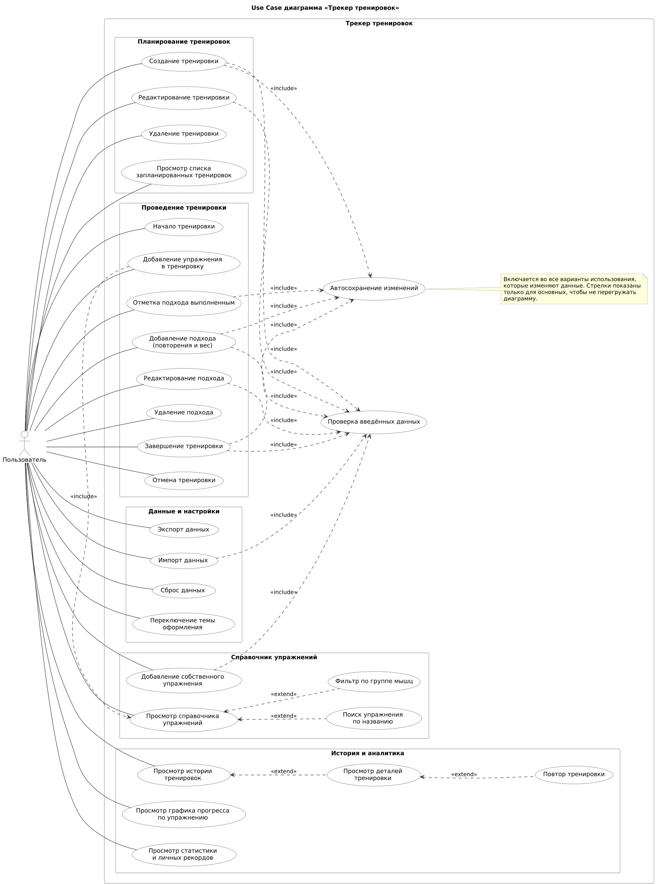
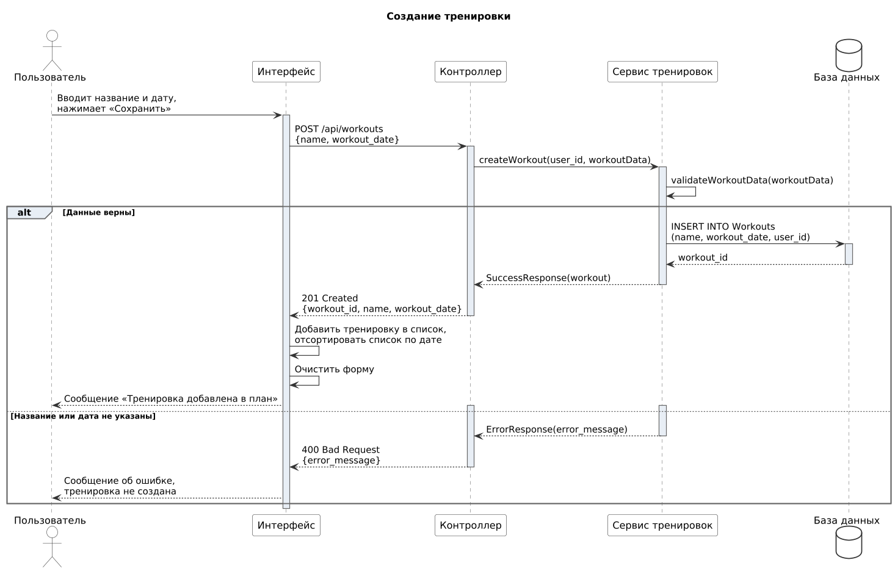
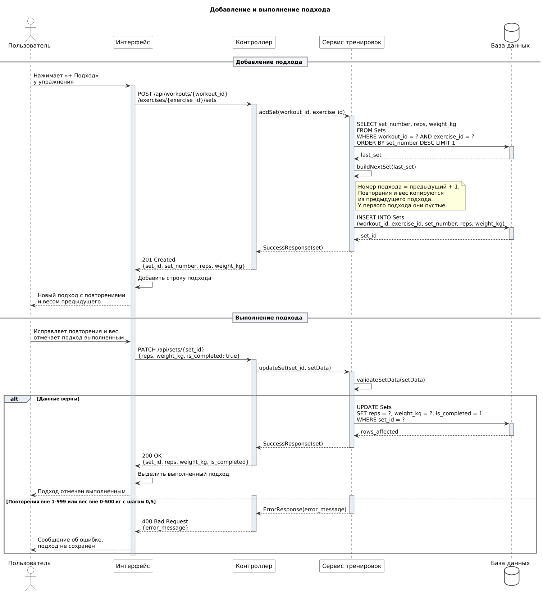
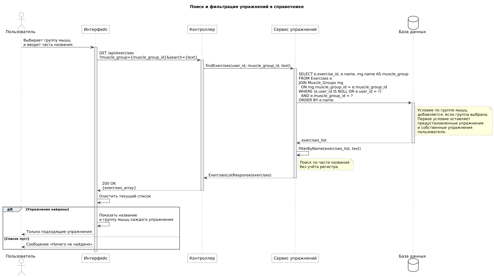
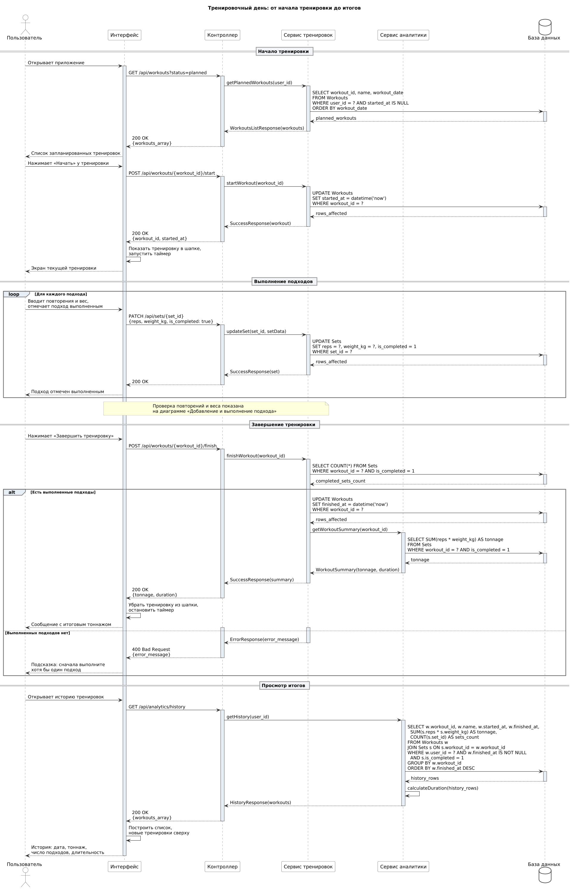

# Диаграммы поведения системы

Документ описывает поведение приложения «Трекер тренировок»: что система делает для пользователя (Use Case диаграмма) и как она это делает (диаграммы последовательности).

Диаграммы построены по [техническому заданию](https://github.com/KirillS997/workout-tracker-srs/wiki/Техническое-задание) и задачам беклога. Имена таблиц и полей в запросах взяты из схемы базы данных [`database/schema.sql`](../../database/schema.sql).

## Use Case Диаграмма

Описание основных сценариев использования приложения «Трекер тренировок».



Файлы: [PNG](../use_case/use_case_diagram.png), [SVG](../use_case/use_case_diagram.svg), [код PlantUML](../use_case/use_case_diagram.puml).

### Акторы:

- **Пользователь** — человек, который планирует тренировки и записывает подходы. Других акторов нет: по ТЗ приложение не обменивается данными с внешними системами.

### Основные Use Cases:

| Группа | Вариант использования | Раздел ТЗ | Задача | В версии 1.0.0 |
|---|---|---|---|---|
| Планирование тренировок | Создание тренировки | 2.1 | [#1](https://github.com/KirillS997/workout-tracker-srs/issues/1) | да |
| | Редактирование тренировки | 2.1 | [#1](https://github.com/KirillS997/workout-tracker-srs/issues/1) | да |
| | Удаление тренировки | 2.1 | [#1](https://github.com/KirillS997/workout-tracker-srs/issues/1) | да |
| | Просмотр списка запланированных тренировок | 2.1 | [#1](https://github.com/KirillS997/workout-tracker-srs/issues/1) | да |
| Проведение тренировки | Начало тренировки | 2.1, 2.5 | [#1](https://github.com/KirillS997/workout-tracker-srs/issues/1), [#10](https://github.com/KirillS997/workout-tracker-srs/issues/10) | да, без таймера |
| | Добавление упражнения в тренировку | 2.1 | [#2](https://github.com/KirillS997/workout-tracker-srs/issues/2) | нет |
| | Добавление подхода (повторения и вес) | 2.2 | [#3](https://github.com/KirillS997/workout-tracker-srs/issues/3), [#12](https://github.com/KirillS997/workout-tracker-srs/issues/12) | нет |
| | Отметка подхода выполненным | 2.2 | [#3](https://github.com/KirillS997/workout-tracker-srs/issues/3) | нет |
| | Редактирование подхода | 2.2 | [#3](https://github.com/KirillS997/workout-tracker-srs/issues/3) | нет |
| | Удаление подхода | 2.2 | [#12](https://github.com/KirillS997/workout-tracker-srs/issues/12) | нет |
| | Завершение тренировки | 2.2 | [#13](https://github.com/KirillS997/workout-tracker-srs/issues/13) | нет |
| | Отмена тренировки | 2.1 | [#1](https://github.com/KirillS997/workout-tracker-srs/issues/1) | да |
| Справочник упражнений | Просмотр справочника упражнений | 2.3 | [#8](https://github.com/KirillS997/workout-tracker-srs/issues/8) | да |
| | Поиск упражнения по названию | 2.3 | [#11](https://github.com/KirillS997/workout-tracker-srs/issues/11) | нет |
| | Фильтр по группе мышц | 2.3 | [#11](https://github.com/KirillS997/workout-tracker-srs/issues/11) | нет |
| | Добавление собственного упражнения | 2.3 | [#2](https://github.com/KirillS997/workout-tracker-srs/issues/2) | нет |
| История и аналитика | Просмотр истории тренировок | 2.4 | [#4](https://github.com/KirillS997/workout-tracker-srs/issues/4) | нет |
| | Просмотр деталей тренировки | 2.4 | [#17](https://github.com/KirillS997/workout-tracker-srs/issues/17) | нет |
| | Повтор тренировки | 2.4 | [#17](https://github.com/KirillS997/workout-tracker-srs/issues/17) | нет |
| | Просмотр графика прогресса по упражнению | 2.4 | [#20](https://github.com/KirillS997/workout-tracker-srs/issues/20) | нет |
| | Просмотр статистики и личных рекордов | 2.5 | [#18](https://github.com/KirillS997/workout-tracker-srs/issues/18), [#21](https://github.com/KirillS997/workout-tracker-srs/issues/21) | нет |
| Данные и настройки | Экспорт данных | 2.6 | [#22](https://github.com/KirillS997/workout-tracker-srs/issues/22) | нет |
| | Импорт данных | 2.6 | [#22](https://github.com/KirillS997/workout-tracker-srs/issues/22) | нет |
| | Сброс данных | 2.6 | [#22](https://github.com/KirillS997/workout-tracker-srs/issues/22) | нет |
| | Переключение темы оформления | 4 | [#16](https://github.com/KirillS997/workout-tracker-srs/issues/16) | нет |
| Общие | Проверка введённых данных | 3 | [#14](https://github.com/KirillS997/workout-tracker-srs/issues/14) | да, для тренировки |
| | Автосохранение изменений | 3 | [#5](https://github.com/KirillS997/workout-tracker-srs/issues/5) | да |

### Связи на диаграмме

- **Сплошная линия** соединяет пользователя с вариантом использования, который он запускает сам.
- **`<<include>>`** — обязательная часть другого варианта использования. Стрелка идёт от основного варианта к включаемому.
  - «Проверка введённых данных» включена в создание и редактирование тренировки, добавление и редактирование подхода, завершение тренировки, добавление собственного упражнения и импорт данных.
  - «Автосохранение изменений» включено во все варианты использования, которые изменяют данные. На диаграмме стрелки показаны только для четырёх основных, чтобы её не перегружать.
  - «Просмотр справочника упражнений» включён в добавление упражнения в тренировку: упражнение выбирается из справочника.
- **`<<extend>>`** — необязательное дополнение. Стрелка идёт от дополнения к основному варианту.
  - Поиск по названию и фильтр по группе мышц дополняют просмотр справочника.
  - Просмотр деталей дополняет просмотр истории, а повтор тренировки дополняет просмотр деталей.

## Диаграммы последовательности

### Участники

| Участник | Роль |
|---|---|
| Пользователь | Выполняет действия в приложении |
| Интерфейс | Страница в браузере: принимает действия пользователя и показывает результат |
| Контроллер | Принимает запрос от интерфейса и передаёт его нужному сервису |
| Сервис тренировок, сервис упражнений | Проверяют данные и выполняют правила предметной области |
| Сервис аналитики | Считает тоннаж, длительность и историю |
| База данных | Хранит данные в таблицах из `database/schema.sql` |

Диаграммы описывают **целевую архитектуру** с сервером и базой данных, спроектированной в лабораторной работе №4. Адреса запросов (`/api/...`) и названия методов — проектное решение, в коде их пока нет.

Прототип версии 1.0.0 устроен проще: всё работает в браузере, а данные лежат в localStorage. Роли в нём те же:

| Участник на диаграмме | Что выполняет эту роль в прототипе |
|---|---|
| Интерфейс | `index.html` и функции вывода в `script.js` (`renderWorkouts`, `showMessage`) |
| Контроллер | Обработчики событий (`handleSaveWorkout`, `handleStartFromForm`) |
| Сервис | Функции проверки и изменения данных (`validateWorkoutInput`) |
| База данных | localStorage и функции `saveState`, `loadState` |

### 1. Создание тренировки

Показывает процесс создания новой тренировки с проверкой данных.



Файлы: [PNG](sequence/create_workout_sequence.png), [SVG](sequence/create_workout_sequence.svg), [код PlantUML](sequence/create_workout_sequence.puml).

- **Вариант использования:** «Создание тренировки» с включённой «Проверкой введённых данных». ТЗ, раздел 2.1; задача [#1](https://github.com/KirillS997/workout-tracker-srs/issues/1).
- **Основной поток:** пользователь вводит название и дату → сервис проверяет данные → в таблицу `Workouts` добавляется строка → интерфейс добавляет тренировку в список, отсортированный по дате, и показывает сообщение.
- **Альтернативный поток:** название или дата не указаны → сервис возвращает ошибку, в базу ничего не записывается, пользователь видит сообщение об ошибке.

### 2. Добавление и выполнение подхода

Демонстрирует, как подход появляется в тренировке и как он отмечается выполненным.



Файлы: [PNG](sequence/add_set_sequence.png), [SVG](sequence/add_set_sequence.svg), [код PlantUML](sequence/add_set_sequence.puml).

- **Варианты использования:** «Добавление подхода», «Отметка подхода выполненным», «Проверка введённых данных». ТЗ, разделы 2.2 и 3; задачи [#3](https://github.com/KirillS997/workout-tracker-srs/issues/3), [#12](https://github.com/KirillS997/workout-tracker-srs/issues/12).
- **Добавление подхода:** сервис находит последний подход этого упражнения и создаёт следующий с теми же повторениями и весом. Так добавление подхода укладывается в 3 действия, как требует раздел 4 ТЗ. У первого подхода поля пустые.
- **Выполнение подхода:** пользователь исправляет значения и отмечает подход → сервис проверяет данные → строка в таблице `Sets` обновляется → интерфейс выделяет выполненный подход.
- **Альтернативный поток:** повторения вне диапазона 1–999 или вес вне 0–500 кг с шагом 0,5 → подход не сохраняется, пользователь видит сообщение об ошибке. Те же границы заданы ограничениями `CHECK` в базе данных.

### 3. Поиск и фильтрация упражнений

Отображает механизм поиска по названию и фильтрации справочника по группе мышц.



Файлы: [PNG](sequence/filter_exercises_sequence.png), [SVG](sequence/filter_exercises_sequence.svg), [код PlantUML](sequence/filter_exercises_sequence.puml).

- **Варианты использования:** «Просмотр справочника упражнений» с дополнениями «Поиск упражнения по названию» и «Фильтр по группе мышц». ТЗ, раздел 2.3; задача [#11](https://github.com/KirillS997/workout-tracker-srs/issues/11).
- **Основной поток:** пользователь выбирает группу мышц и вводит часть названия → база данных возвращает упражнения этой группы → сервис оставляет те, в названии которых есть введённый текст → интерфейс показывает название и группу мышц каждого упражнения.
- **Почему поиск по названию выполняет сервис, а не запрос.** Оператор `LIKE` в SQLite не учитывает регистр только для латинских букв. На тестовых данных `LIKE '%тяга%'` находит 2 упражнения, а `LIKE '%Тяга%'` — 4. Задача [#11](https://github.com/KirillS997/workout-tracker-srs/issues/11) требует поиск без учёта регистра, поэтому названия сравнивает сервис.
- **Альтернативный поток:** подходящих упражнений нет → интерфейс показывает сообщение «Ничего не найдено».

### 4. Тренировочный день

Комплексный сценарий: от открытия приложения до просмотра итогов в истории.



Файлы: [PNG](sequence/workout_session_sequence.png), [SVG](sequence/workout_session_sequence.svg), [код PlantUML](sequence/workout_session_sequence.puml).

| Часть | Что происходит | Раздел ТЗ, задача |
|---|---|---|
| Начало тренировки | Интерфейс получает список запланированных тренировок. Пользователь нажимает «Начать», в `Workouts.started_at` записывается время начала, запускается таймер | 2.1, 2.5; [#1](https://github.com/KirillS997/workout-tracker-srs/issues/1), [#10](https://github.com/KirillS997/workout-tracker-srs/issues/10) |
| Выполнение подходов | Цикл: для каждого подхода пользователь вводит повторения и вес и отмечает подход выполненным | 2.2; [#3](https://github.com/KirillS997/workout-tracker-srs/issues/3) |
| Завершение тренировки | Сервис проверяет, что есть выполненные подходы. Если есть — записывает `finished_at`, сервис аналитики считает тоннаж, пользователь видит итог. Если нет — завершение блокируется с подсказкой | 2.2; [#13](https://github.com/KirillS997/workout-tracker-srs/issues/13) |
| Просмотр итогов | Сервис аналитики собирает историю завершённых тренировок: дата, тоннаж, число подходов, длительность; новые сверху | 2.4; [#4](https://github.com/KirillS997/workout-tracker-srs/issues/4) |

Статус и длительность тренировки в базе не хранятся. Тренировка считается запланированной, пока `started_at` пуст, и завершённой, когда заполнен `finished_at`; длительность равна их разности.

## Используемые инструменты

- **PlantUML** (версия 1.2024.7) — все диаграммы описаны кодом в файлах `.puml` и экспортированы в PNG и SVG.
- **Graphviz** — нужен PlantUML для размещения элементов Use Case диаграммы.
- **draw.io** не использовался: код PlantUML удобнее хранить в Git и проще править.

Как получить картинки заново:

```
java -jar plantuml.jar -tpng -tsvg docs/use_case/*.puml docs/behavior/sequence/*.puml
```

Без установки: вставить содержимое файла `.puml` на [plantuml.com/plantuml](https://www.plantuml.com/plantuml).

## Файлы

```
docs/
  use_case/
    use_case_diagram.puml / .png / .svg
  behavior/
    README.md
    sequence/
      create_workout_sequence.puml / .png / .svg
      add_set_sequence.puml / .png / .svg
      filter_exercises_sequence.puml / .png / .svg
      workout_session_sequence.puml / .png / .svg
```
