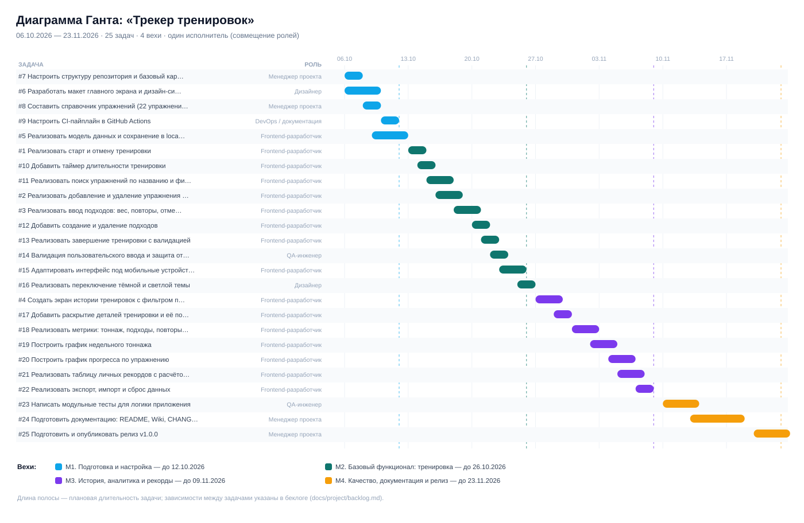

# Беклог продукта «Трекер тренировок»

**Всего задач:** 25 · **Вех:** 4 · **Сложность:** small — 12, medium — 13, large — 0

Беклог декомпозирован из [исходных материалов лабораторной №1](../../README.md). Каждая задача оформлена как Issue с User Story, критериями приёмки, ролью, вехой, оценкой сложности и зависимостями.

## 1. Вехи проекта (Milestones)

| Веха | Название | Период | Содержание |
|---|---|---|---|
| M1 | Подготовка и настройка | 06.10.2026 – 12.10.2026 | Настройка окружения, макет интерфейса, модель данных, CI. |
| M2 | Базовый функционал: тренировка | 13.10.2026 – 26.10.2026 | Полный цикл записи тренировки: старт, упражнения, подходы, завершение. |
| M3 | История, аналитика и рекорды | 27.10.2026 – 09.11.2026 | История тренировок, графики, личные рекорды, экспорт данных. |
| M4 | Качество, документация и релиз | 10.11.2026 – 23.11.2026 | Тесты, документация, релиз v1.0.0. |

## 2. Распределение ролей

Работа выполняется одним человеком, который совмещает все роли. Для целей планирования за каждой задачей закреплена одна основная роль.

| Роль | Метка | Задач | Основные обязанности |
|---|---|---|---|
| Менеджер проекта | `role: pm` | 4 | планирование, ТЗ, беклог, релиз, документация |
| Frontend-разработчик | `role: frontend` | 16 | реализация интерфейса и логики приложения |
| QA-инженер | `role: qa` | 2 | тест-план, проверка критериев приёмки, автотесты |
| Дизайнер | `role: designer` | 2 | макеты, дизайн-система, адаптивность, темы |
| DevOps / документация | `role: devops` | 1 | CI/CD, структура репозитория, релизный процесс |

## 3. Полный беклог

| # | Задача | Роль | Сложность | Веха | План | Зависит от |
|---|---|---|---|---|---|---|
| 7 | [Настроить структуру репозитория и базовый каркас страницы](https://github.com/KirillS997/workout-tracker-srs/issues/7) | Менеджер проекта | низкая | M1 | 06.10–07.10 | — |
| 6 | [Разработать макет главного экрана и дизайн-систему](https://github.com/KirillS997/workout-tracker-srs/issues/6) | Дизайнер | средняя | M1 | 06.10–09.10 | — |
| 8 | [Составить справочник упражнений (22 упражнения, 6 групп мышц)](https://github.com/KirillS997/workout-tracker-srs/issues/8) | Менеджер проекта | низкая | M1 | 08.10–09.10 | #7 |
| 9 | [Настроить CI-пайплайн в GitHub Actions](https://github.com/KirillS997/workout-tracker-srs/issues/9) | DevOps / документация | низкая | M1 | 10.10–11.10 | #7 |
| 5 | [Реализовать модель данных и сохранение в localStorage](https://github.com/KirillS997/workout-tracker-srs/issues/5) | Frontend-разработчик | средняя | M1 | 09.10–12.10 | #7 |
| 1 | [Реализовать старт и отмену тренировки](https://github.com/KirillS997/workout-tracker-srs/issues/1) | Frontend-разработчик | низкая | M2 | 13.10–14.10 | #5 |
| 10 | [Добавить таймер длительности тренировки](https://github.com/KirillS997/workout-tracker-srs/issues/10) | Frontend-разработчик | низкая | M2 | 14.10–15.10 | #1 |
| 11 | [Реализовать поиск упражнений по названию и фильтр по группе мышц](https://github.com/KirillS997/workout-tracker-srs/issues/11) | Frontend-разработчик | средняя | M2 | 15.10–17.10 | #8 |
| 2 | [Реализовать добавление и удаление упражнения в тренировке](https://github.com/KirillS997/workout-tracker-srs/issues/2) | Frontend-разработчик | средняя | M2 | 16.10–18.10 | #11 |
| 3 | [Реализовать ввод подходов: вес, повторы, отметка выполнения](https://github.com/KirillS997/workout-tracker-srs/issues/3) | Frontend-разработчик | средняя | M2 | 18.10–20.10 | #2 |
| 12 | [Добавить создание и удаление подходов](https://github.com/KirillS997/workout-tracker-srs/issues/12) | Frontend-разработчик | низкая | M2 | 20.10–21.10 | #3 |
| 13 | [Реализовать завершение тренировки с валидацией](https://github.com/KirillS997/workout-tracker-srs/issues/13) | Frontend-разработчик | низкая | M2 | 21.10–22.10 | #3 |
| 14 | [Валидация пользовательского ввода и защита от XSS](https://github.com/KirillS997/workout-tracker-srs/issues/14) | QA-инженер | низкая | M2 | 22.10–23.10 | #3 |
| 15 | [Адаптировать интерфейс под мобильные устройства](https://github.com/KirillS997/workout-tracker-srs/issues/15) | Frontend-разработчик | средняя | M2 | 23.10–25.10 | #6 |
| 16 | [Реализовать переключение тёмной и светлой темы](https://github.com/KirillS997/workout-tracker-srs/issues/16) | Дизайнер | низкая | M2 | 25.10–26.10 | #6 |
| 4 | [Создать экран истории тренировок с фильтром по периоду](https://github.com/KirillS997/workout-tracker-srs/issues/4) | Frontend-разработчик | средняя | M3 | 27.10–29.10 | #13 |
| 17 | [Добавить раскрытие деталей тренировки и её повтор](https://github.com/KirillS997/workout-tracker-srs/issues/17) | Frontend-разработчик | низкая | M3 | 29.10–30.10 | #4 |
| 18 | [Реализовать метрики: тоннаж, подходы, повторы, средняя длительность](https://github.com/KirillS997/workout-tracker-srs/issues/18) | Frontend-разработчик | средняя | M3 | 31.10–02.11 | #4 |
| 19 | [Построить график недельного тоннажа](https://github.com/KirillS997/workout-tracker-srs/issues/19) | Frontend-разработчик | средняя | M3 | 02.11–04.11 | #18 |
| 20 | [Построить график прогресса по упражнению](https://github.com/KirillS997/workout-tracker-srs/issues/20) | Frontend-разработчик | средняя | M3 | 04.11–06.11 | #19 |
| 21 | [Реализовать таблицу личных рекордов с расчётом 1ПМ](https://github.com/KirillS997/workout-tracker-srs/issues/21) | Frontend-разработчик | средняя | M3 | 05.11–07.11 | #18 |
| 22 | [Реализовать экспорт, импорт и сброс данных](https://github.com/KirillS997/workout-tracker-srs/issues/22) | Frontend-разработчик | низкая | M3 | 07.11–08.11 | #5 |
| 23 | [Написать модульные тесты для логики приложения](https://github.com/KirillS997/workout-tracker-srs/issues/23) | QA-инженер | средняя | M4 | 10.11–13.11 | #21, #22 |
| 24 | [Подготовить документацию: README, Wiki, CHANGELOG](https://github.com/KirillS997/workout-tracker-srs/issues/24) | Менеджер проекта | средняя | M4 | 13.11–18.11 | #23 |
| 25 | [Подготовить и опубликовать релиз v1.0.0](https://github.com/KirillS997/workout-tracker-srs/issues/25) | Менеджер проекта | низкая | M4 | 20.11–23.11 | #24 |

## 4. Задачи по вехам

### M1. Подготовка и настройка (06.10.2026 – 12.10.2026)

Настройка окружения, макет интерфейса, модель данных, CI.

#### #7 Настроить структуру репозитория и базовый каркас страницы

**User Story.** Как разработчик, я хочу иметь готовую структуру проекта с index.html, style.css, script.js, чтобы не тратить время на организацию файлов в процессе работы.

**Роль:** Менеджер проекта · **Сложность:** низкая · **План:** 06.10–07.10 · **Зависимости:** нет

**Критерии приёмки:**
- [ ] В репозитории есть файлы index.html, style.css, script.js, .gitignore, README.md
- [ ] index.html подключает стили и скрипт
- [ ] Первый коммит оформлен в стиле feat: add basic project structure
- [ ] Ветка main защищена от случайных прямых пушей (по возможности)

#### #6 Разработать макет главного экрана и дизайн-систему

**User Story.** Как пользователь, я хочу видеть понятный экран тренировки с крупными элементами, чтобы записывать подходы между сетами, не всматриваясь в интерфейс.

**Роль:** Дизайнер · **Сложность:** средняя · **План:** 06.10–09.10 · **Зависимости:** нет

**Критерии приёмки:**
- [ ] Определены цвета, типографика, отступы, радиусы (CSS-переменные)
- [ ] Есть тёмная тема по умолчанию
- [ ] Макет покрывает экраны: тренировка, история, аналитика, рекорды, настройки
- [ ] Контраст текста соответствует WCAG AA

#### #8 Составить справочник упражнений (22 упражнения, 6 групп мышц)

**User Story.** Как пользователь, я хочу выбирать упражнения из готового списка с группой мышц, чтобы не вводить названия вручную и не ошибаться в написании.

**Роль:** Менеджер проекта · **Сложность:** низкая · **План:** 08.10–09.10 · **Зависимости:** #7

**Критерии приёмки:**
- [ ] Справочник содержит минимум 20 упражнений
- [ ] У каждого упражнения указаны название и группа мышц
- [ ] Группы мышц: грудь, спина, ноги, плечи, руки, пресс
- [ ] Справочник вынесен в отдельную структуру данных в script.js

#### #9 Настроить CI-пайплайн в GitHub Actions

**User Story.** Как разработчик, я хочу, чтобы при каждом PR автоматически проверялись структура и тесты, чтобы не тащить в main сломанный код.

**Роль:** DevOps / документация · **Сложность:** низкая · **План:** 10.10–11.10 · **Зависимости:** #7

**Критерии приёмки:**
- [ ] Создан файл .github/workflows/ci.yml
- [ ] Проверка запускается на push в main и на pull_request
- [ ] CI проверяет наличие обязательных файлов и синтаксис JS
- [ ] Успешный запуск отображается зелёной галочкой в PR

#### #5 Реализовать модель данных и сохранение в localStorage

**User Story.** Как пользователь, я хочу, чтобы данные не терялись при закрытии вкладки, чтобы вести дневник тренировок месяцами без потерь.

**Роль:** Frontend-разработчик · **Сложность:** средняя · **План:** 09.10–12.10 · **Зависимости:** #7

**Критерии приёмки:**
- [ ] Состояние хранится в localStorage под ключом workout-tracker:v1
- [ ] Структура: workouts → exercises → sets
- [ ] Данные восстанавливаются при перезагрузке страницы
- [ ] Повреждённый JSON не приводит к падению приложения (откат к пустому состоянию)

### M2. Базовый функционал: тренировка (13.10.2026 – 26.10.2026)

Полный цикл записи тренировки: старт, упражнения, подходы, завершение.

#### #1 Реализовать старт и отмену тренировки

**User Story.** Как пользователь, я хочу начать новую тренировку и указать её название, чтобы отделить одну тренировку от другой в истории.

**Роль:** Frontend-разработчик · **Сложность:** низкая · **План:** 13.10–14.10 · **Зависимости:** #5

**Критерии приёмки:**
- [ ] Есть поле ввода названия и кнопка «Начать»
- [ ] Пустое название не создаёт тренировку и показывает сообщение
- [ ] Отмена требует подтверждения и не сохраняет данные
- [ ] Активная тренировка отображается в шапке страницы

#### #10 Добавить таймер длительности тренировки

**User Story.** Как пользователь, я хочу видеть, сколько длится тренировка, чтобы контролировать время отдыха и общую продолжительность.

**Роль:** Frontend-разработчик · **Сложность:** низкая · **План:** 14.10–15.10 · **Зависимости:** #1

**Критерии приёмки:**
- [ ] Таймер стартует вместе с тренировкой
- [ ] Формат отображения MM:SS, после часа — H:MM:SS
- [ ] Таймер останавливается при завершении или отмене
- [ ] Длительность сохраняется в истории тренировки

#### #11 Реализовать поиск упражнений по названию и фильтр по группе мышц

**User Story.** Как пользователь, я хочу быстро находить упражнение в каталоге, чтобы не листать весь список во время тренировки.

**Роль:** Frontend-разработчик · **Сложность:** средняя · **План:** 15.10–17.10 · **Зависимости:** #8

**Критерии приёмки:**
- [ ] Поиск фильтрует каталог по подстроке без учёта регистра
- [ ] Фильтр по группе мышц работает вместе с поиском
- [ ] Результаты показывают название и группу мышц
- [ ] Повторное добавление упражнения блокируется с сообщением

#### #2 Реализовать добавление и удаление упражнения в тренировке

**User Story.** Как пользователь, я хочу добавлять упражнения в тренировку и убирать ошибочно выбранные, чтобы состав тренировки соответствовал плану.

**Роль:** Frontend-разработчик · **Сложность:** средняя · **План:** 16.10–18.10 · **Зависимости:** #11

**Критерии приёмки:**
- [ ] Упражнение добавляется кликом по результату поиска или Enter
- [ ] Удаление требует подтверждения
- [ ] Пустой список показывает подсказку «добавьте первое упражнение»
- [ ] Изменения сразу сохраняются в localStorage

#### #3 Реализовать ввод подходов: вес, повторы, отметка выполнения

**User Story.** Как пользователь, я хочу записывать вес и количество повторов в каждом подходе, чтобы отслеживать нагрузку и прогресс.

**Роль:** Frontend-разработчик · **Сложность:** средняя · **План:** 18.10–20.10 · **Зависимости:** #2

**Критерии приёмки:**
- [ ] Для каждого подхода есть поля «вес» и «повторы» и чекбокс выполнения
- [ ] Отрицательные значения и текст не принимаются
- [ ] Выполненный подход визуально отличается
- [ ] Ввод сохраняется без отдельной кнопки

#### #12 Добавить создание и удаление подходов

**User Story.** Как пользователь, я хочу добавлять новые подходы одним кликом, чтобы не заполнять вес заново для каждого сета.

**Роль:** Frontend-разработчик · **Сложность:** низкая · **План:** 20.10–21.10 · **Зависимости:** #3

**Критерии приёмки:**
- [ ] Кнопка «+ Подход» добавляет подход с весом и повторами предыдущего
- [ ] Удаление подхода доступно для каждой строки
- [ ] Удаление последнего подхода удаляет упражнение из тренировки
- [ ] Нумерация подходов пересчитывается

#### #13 Реализовать завершение тренировки с валидацией

**User Story.** Как пользователь, я хочу завершить тренировку и увидеть её итог, чтобы зафиксировать результат в дневнике.

**Роль:** Frontend-разработчик · **Сложность:** низкая · **План:** 21.10–22.10 · **Зависимости:** #3

**Критерии приёмки:**
- [ ] Без упражнений или без заполненных подходов завершение блокируется с подсказкой
- [ ] После завершения тренировка попадает в историю с датой и временем
- [ ] Активная тренировка очищается
- [ ] Показывается сообщение с итоговым тоннажом

#### #14 Валидация пользовательского ввода и защита от XSS

**User Story.** Как QA-инженер, я хочу, чтобы все пользовательские строки экранировались и проверялись, чтобы приложение не ломалось и не выполняло чужой скрипт.

**Роль:** QA-инженер · **Сложность:** низкая · **План:** 22.10–23.10 · **Зависимости:** #3

**Критерии приёмки:**
- [ ] Названия тренировок и упражнений проходят через escapeHtml
- [ ] Скрипт не использует eval и innerHTML с необработанными данными
- [ ] Проверены случаи: пустая строка, 0, 10000 повторов, отрицательный вес
- [ ] Найденные дефекты заведены отдельными Issues

#### #15 Адаптировать интерфейс под мобильные устройства

**User Story.** Как пользователь, я хочу записывать тренировку с телефона прямо в зале, чтобы не носить с собой ноутбук.

**Роль:** Frontend-разработчик · **Сложность:** средняя · **План:** 23.10–25.10 · **Зависимости:** #6

**Критерии приёмки:**
- [ ] Вёрстка не ломается при ширине 360–1440 px
- [ ] Элементы управления не меньше 44 px по высоте
- [ ] Поля ввода используют корректную клавиатуру (числовой ввод)
- [ ] Кнопки в карточке занимают всю ширину на узких экранах

#### #16 Реализовать переключение тёмной и светлой темы

**User Story.** Как пользователь, я хочу переключать тему оформления, чтобы интерфейс был комфортным при любом освещении.

**Роль:** Дизайнер · **Сложность:** низкая · **План:** 25.10–26.10 · **Зависимости:** #6

**Критерии приёмки:**
- [ ] Тема переключается в настройках
- [ ] Выбор сохраняется в localStorage
- [ ] Все экраны корректно отображаются в обеих темах
- [ ] Соблюдён контраст текста

### M3. История, аналитика и рекорды (27.10.2026 – 09.11.2026)

История тренировок, графики, личные рекорды, экспорт данных.

#### #4 Создать экран истории тренировок с фильтром по периоду

**User Story.** Как пользователь, я хочу видеть список прошедших тренировок, чтобы вспоминать, что и когда я делал.

**Роль:** Frontend-разработчик · **Сложность:** средняя · **План:** 27.10–29.10 · **Зависимости:** #13

**Критерии приёмки:**
- [ ] Список отсортирован по дате: новые сверху
- [ ] Фильтры: всё время, 7, 30, 90 дней
- [ ] В строке видны дата, тоннаж, число подходов, длительность
- [ ] Пустая история показывает подсказку

#### #17 Добавить раскрытие деталей тренировки и её повтор

**User Story.** Как пользователь, я хочу раскрыть тренировку и посмотреть все подходы, а затем повторить её, чтобы не составлять план заново.

**Роль:** Frontend-разработчик · **Сложность:** низкая · **План:** 29.10–30.10 · **Зависимости:** #4

**Критерии приёмки:**
- [ ] Клик по тренировке раскрывает упражнения и подходы
- [ ] Кнопка «Повторить» создаёт новую тренировку с тем же составом
- [ ] Подходы в повторе пустые (без веса и повторов)
- [ ] Есть предупреждение при незавершённой текущей тренировке

#### #18 Реализовать метрики: тоннаж, подходы, повторы, средняя длительность

**User Story.** Как пользователь, я хочу видеть сводные показатели своего дневника, чтобы понимать объём работы в цифрах.

**Роль:** Frontend-разработчик · **Сложность:** средняя · **План:** 31.10–02.11 · **Зависимости:** #4

**Критерии приёмки:**
- [ ] Панель метрик содержит: тренировок, тоннаж, подходы, повторы, среднюю длительность
- [ ] Тоннаж отображается в тоннах с одним знаком
- [ ] Метрики пересчитываются после каждой тренировки
- [ ] При отсутствии данных показываются нули, а не ошибка

#### #19 Построить график недельного тоннажа

**User Story.** Как пользователь, я хочу видеть динамику тоннажа по неделям, чтобы оценивать, расту ли я в объёме нагрузки.

**Роль:** Frontend-разработчик · **Сложность:** средняя · **План:** 02.11–04.11 · **Зависимости:** #18

**Критерии приёмки:**
- [ ] График показывает 8 последних недель
- [ ] Столбцы подписаны датами начала недели
- [ ] Подсказка при наведении показывает точное значение
- [ ] График строится без сторонних библиотек (SVG)
- [ ] При отсутствии данных показывается заглушка

#### #20 Построить график прогресса по упражнению

**User Story.** Как пользователь, я хочу видеть, как растёт мой рабочий вес в конкретном упражнении, чтобы вовремя заметить застой.

**Роль:** Frontend-разработчик · **Сложность:** средняя · **План:** 04.11–06.11 · **Зависимости:** #19

**Критерии приёмки:**
- [ ] Выбор упражнения из списка тех, что есть в истории
- [ ] График показывает лучший подход каждой тренировки
- [ ] Точки подписаны значениями веса и датами
- [ ] Данные ограничены последними 12 тренировками

#### #21 Реализовать таблицу личных рекордов с расчётом 1ПМ

**User Story.** Как пользователь, я хочу видеть свои лучшие результаты по каждому упражнению, чтобы ставить цели на следующую тренировку.

**Роль:** Frontend-разработчик · **Сложность:** средняя · **План:** 05.11–07.11 · **Зависимости:** #18

**Критерии приёмки:**
- [ ] 1ПМ считается по формуле Эпли: вес × (1 + повторы / 30)
- [ ] Рекорд определяется по наибольшему расчётному 1ПМ, а не по весу
- [ ] Для каждого упражнения показаны вес, повторы, 1ПМ и дата
- [ ] Таблица отсортирована по убыванию 1ПМ

#### #22 Реализовать экспорт, импорт и сброс данных

**User Story.** Как пользователь, я хочу выгружать свой дневник в файл и загружать его обратно, чтобы не потерять данные при смене браузера или устройства.

**Роль:** Frontend-разработчик · **Сложность:** низкая · **План:** 07.11–08.11 · **Зависимости:** #5

**Критерии приёмки:**
- [ ] Экспорт скачивает JSON с датой в имени файла
- [ ] Импорт проверяет структуру файла и сообщает об ошибке
- [ ] Сброс данных требует подтверждения
- [ ] После импорта интерфейс обновляется без перезагрузки страницы

### M4. Качество, документация и релиз (10.11.2026 – 23.11.2026)

Тесты, документация, релиз v1.0.0.

#### #23 Написать модульные тесты для логики приложения

**User Story.** Как QA-инженер, я хочу автоматически проверять расчёты тоннажа, 1ПМ и валидацию, чтобы рефакторинг не ломал бизнес-логику.

**Роль:** QA-инженер · **Сложность:** средняя · **План:** 10.11–13.11 · **Зависимости:** #21, #22

**Критерии приёмки:**
- [ ] Тесты запускаются командой node tests/app.test.js
- [ ] Покрыты: тоннаж, 1ПМ, длительность, экранирование, нормализация состояния
- [ ] Покрыты сценарии старта и завершения тренировки
- [ ] CI падает, если тест не проходит

#### #24 Подготовить документацию: README, Wiki, CHANGELOG

**User Story.** Как проверяющий, я хочу из README и Wiki понять, как запустить проект и как он устроен, чтобы оценить работу без чтения всего кода.

**Роль:** Менеджер проекта · **Сложность:** средняя · **План:** 13.11–18.11 · **Зависимости:** #23

**Критерии приёмки:**
- [ ] README содержит описание, скриншоты, инструкцию запуска
- [ ] Wiki: Техническое задание, План проекта, Процесс разработки, Нормализация БД
- [ ] CHANGELOG описывает версии по Keep a Changelog
- [ ] Ссылки в документации рабочие

#### #25 Подготовить и опубликовать релиз v1.0.0

**User Story.** Как пользователь, я хочу скачать стабильную версию приложения, чтобы быть уверенным, что она проверена тестами.

**Роль:** Менеджер проекта · **Сложность:** низкая · **План:** 20.11–23.11 · **Зависимости:** #24

**Критерии приёмки:**
- [ ] Тег v1.0.0 соответствует SemVer
- [ ] Release содержит описание возможностей и ссылку на демо
- [ ] CI на момент релиза зелёный
- [ ] Закрыты все Issues вехи M4

## 5. Метрики плана

- Общее количество задач: **25**
- Задач высокой сложности: **0**
- Задач средней сложности: **13**
- Задач низкой сложности: **12**
- Планируемая длительность: **48 дней (6.9 недели)**
- Средняя нагрузка: ~2 задачи в день при 8-часовом рабочем дне (совмещение ролей)

## 6. Диаграмма Ганта

Интерактивная версия плана — в GitHub Projects (вид Roadmap): см. [План проекта в Wiki](../wiki/План-проекта.md).
