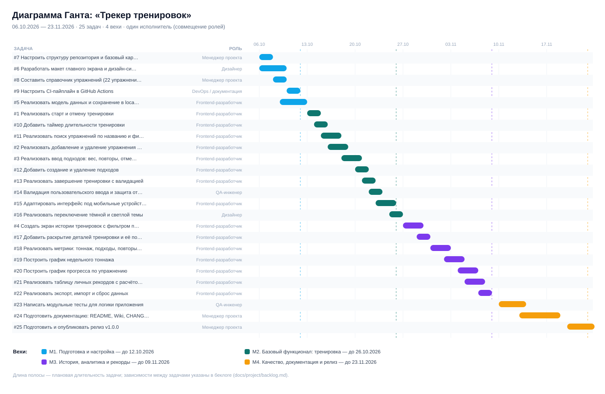

# План проекта «Трекер тренировок»

> Страница создана в рамках лабораторной работы №2 «Планирование проекта и управление командой».

## 1. Участники команды и роли

Проект выполняется индивидуально: один человек совмещает все роли, поэтому в беклоге у каждой задачи указана одна основная роль.

| Роль | Участник | Основные обязанности |
|------|-----|---------------------|
| Менеджер проекта | KirillS997 | Планирование, ТЗ, беклог, контроль сроков, релиз |
| Frontend-разработчик | KirillS997 | Разработка интерфейса и логики приложения |
| QA-инженер | KirillS997 | Тестирование, критерии приёмки, автотесты |
| Дизайнер | KirillS997 | Макеты, дизайн-система, адаптивность |
| DevOps | KirillS997 | CI/CD, структура репозитория, процесс релиза |

## 2. Беклог продукта и этапы

**Всего задач в беклоге:** 25

Основные этапы проекта (Milestones):

- **M1. Подготовка и настройка** (завершение 12.10.2026) — Настройка окружения, макет интерфейса, модель данных, CI. Задач: 5.
- **M2. Базовый функционал: тренировка** (завершение 26.10.2026) — Полный цикл записи тренировки: старт, упражнения, подходы, завершение. Задач: 10.
- **M3. История, аналитика и рекорды** (завершение 09.11.2026) — История тренировок, графики, личные рекорды, экспорт данных. Задач: 7.
- **M4. Качество, документация и релиз** (завершение 23.11.2026) — Тесты, документация, релиз v1.0.0. Задач: 3.

## 3. Визуализация плана

Диаграмма Ганта опубликована ниже. GitHub Projects / Roadmap ещё не настроен: требуется отдельный доступ к личным Projects. Статическая диаграмма не заменяет обязательный вид Roadmap.

Файл диаграммы: [gantt.svg](../project/gantt.svg).

## 4. Ключевые метрики

- Общее количество задач: 25
- Задач высокой сложности: 0
- Задач средней сложности: 13
- Задач низкой сложности: 12
- Планируемая длительность проекта: 7 недель (06.10.2026 — 23.11.2026)
- Количество вех: 4

## 5. Правила работы с беклогом

1. Любая работа начинается с Issue: без задачи нет ветки и PR.
2. Ветка создаётся от `main` по шаблону `feature/<номер>-<краткое-имя>`.
3. PR обязательно ссылается на задачу через `Closes #<номер>`.
4. Мерж возможен только при зелёном CI и пройденном self-review.
5. После мержа Issue закрывается автоматически, задача переносится в колонку Done.

## 6. Риски и меры

| Риск | Вероятность | Влияние | Мера |
|---|---|---|---|
| Потеря данных в localStorage при чистке браузера | средняя | высокое | Экспорт JSON (задача #22), предупреждение в настройках |
| Расползание объёма (scope creep) | высокая | среднее | Фиксированный беклог из 25 задач, новые идеи — в отдельный список «После v1.0» |
| Отсутствие реального устройства для тестов | средняя | низкое | Проверка в DevTools (responsive mode) + jsdom-тесты |
| Совмещение всех ролей одним человеком | высокая | среднее | Буфер 20% времени в каждой вехе, жёсткие критерии DoD |

## Статус планирования

Даты в плане — плановые, а не фактические даты выполнения. Задачи не закрываются до реализации. Шесть исходных Issues лабораторной №1 сохранены и дополнены; создано 19 новых, всего в беклоге 25.

## Календарный план задач

| Issue | Задача | Этап | Плановые даты |
|---|---|---|---|
| [#1](https://github.com/KirillS997/workout-tracker-srs/issues/1) | Реализовать создание тренировки | M2 | 13.10.2026 — 14.10.2026 |
| [#2](https://github.com/KirillS997/workout-tracker-srs/issues/2) | Реализовать добавление упражнений в тренировку | M2 | 16.10.2026 — 18.10.2026 |
| [#3](https://github.com/KirillS997/workout-tracker-srs/issues/3) | Реализовать учёт подходов, повторений и весов | M2 | 18.10.2026 — 20.10.2026 |
| [#4](https://github.com/KirillS997/workout-tracker-srs/issues/4) | Реализовать историю тренировок и график прогресса | M3 | 27.10.2026 — 29.10.2026 |
| [#5](https://github.com/KirillS997/workout-tracker-srs/issues/5) | Реализовать автосохранение и загрузку данных | M1 | 09.10.2026 — 12.10.2026 |
| [#6](https://github.com/KirillS997/workout-tracker-srs/issues/6) | Разработать макет экрана текущей тренировки | M1 | 06.10.2026 — 09.10.2026 |
| [#7](https://github.com/KirillS997/workout-tracker-srs/issues/7) | Настроить структуру репозитория и базовый каркас страницы | M1 | 06.10.2026 — 07.10.2026 |
| [#8](https://github.com/KirillS997/workout-tracker-srs/issues/8) | Составить справочник упражнений (22 упражнения, 6 групп мышц) | M1 | 08.10.2026 — 09.10.2026 |
| [#9](https://github.com/KirillS997/workout-tracker-srs/issues/9) | Настроить CI-пайплайн в GitHub Actions | M1 | 10.10.2026 — 11.10.2026 |
| [#10](https://github.com/KirillS997/workout-tracker-srs/issues/10) | Добавить таймер длительности тренировки | M2 | 14.10.2026 — 15.10.2026 |
| [#11](https://github.com/KirillS997/workout-tracker-srs/issues/11) | Реализовать поиск упражнений по названию и фильтр по группе мышц | M2 | 15.10.2026 — 17.10.2026 |
| [#12](https://github.com/KirillS997/workout-tracker-srs/issues/12) | Добавить создание и удаление подходов | M2 | 20.10.2026 — 21.10.2026 |
| [#13](https://github.com/KirillS997/workout-tracker-srs/issues/13) | Реализовать завершение тренировки с валидацией | M2 | 21.10.2026 — 22.10.2026 |
| [#14](https://github.com/KirillS997/workout-tracker-srs/issues/14) | Валидация пользовательского ввода и защита от XSS | M2 | 22.10.2026 — 23.10.2026 |
| [#15](https://github.com/KirillS997/workout-tracker-srs/issues/15) | Адаптировать интерфейс под мобильные устройства | M2 | 23.10.2026 — 25.10.2026 |
| [#16](https://github.com/KirillS997/workout-tracker-srs/issues/16) | Реализовать переключение тёмной и светлой темы | M2 | 25.10.2026 — 26.10.2026 |
| [#17](https://github.com/KirillS997/workout-tracker-srs/issues/17) | Добавить раскрытие деталей тренировки и её повтор | M3 | 29.10.2026 — 30.10.2026 |
| [#18](https://github.com/KirillS997/workout-tracker-srs/issues/18) | Реализовать метрики: тоннаж, подходы, повторы, средняя длительность | M3 | 31.10.2026 — 02.11.2026 |
| [#19](https://github.com/KirillS997/workout-tracker-srs/issues/19) | Построить график недельного тоннажа | M3 | 02.11.2026 — 04.11.2026 |
| [#20](https://github.com/KirillS997/workout-tracker-srs/issues/20) | Построить график прогресса по упражнению | M3 | 04.11.2026 — 06.11.2026 |
| [#21](https://github.com/KirillS997/workout-tracker-srs/issues/21) | Реализовать таблицу личных рекордов с расчётом 1ПМ | M3 | 05.11.2026 — 07.11.2026 |
| [#22](https://github.com/KirillS997/workout-tracker-srs/issues/22) | Реализовать экспорт, импорт и сброс данных | M3 | 07.11.2026 — 08.11.2026 |
| [#23](https://github.com/KirillS997/workout-tracker-srs/issues/23) | Написать модульные тесты для логики приложения | M4 | 10.11.2026 — 13.11.2026 |
| [#24](https://github.com/KirillS997/workout-tracker-srs/issues/24) | Подготовить документацию: README, Wiki, CHANGELOG | M4 | 13.11.2026 — 18.11.2026 |
| [#25](https://github.com/KirillS997/workout-tracker-srs/issues/25) | Подготовить и опубликовать релиз v1.0.0 | M4 | 20.11.2026 — 23.11.2026 |

## Навигация

- [Исходные материалы лабораторной №1](https://github.com/KirillS997/workout-tracker-srs)
- [Беклог и календарный план](https://github.com/KirillS997/workout-tracker-srs/blob/main/docs/project/backlog.md)
- [Issues](https://github.com/KirillS997/workout-tracker-srs/issues)
- [Milestones](https://github.com/KirillS997/workout-tracker-srs/milestones)
